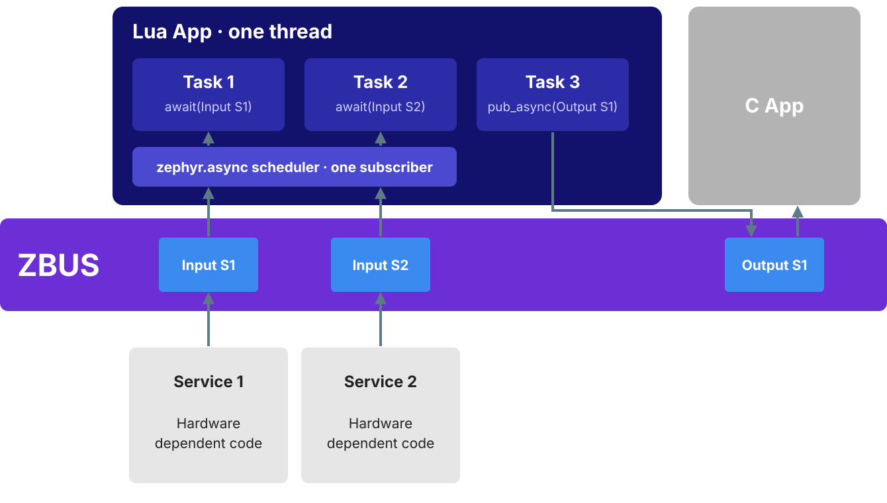

# Lua for Zephyr RTOS

> Alpha release: the API may change. Feedback is welcome.

A [Zephyr RTOS](https://zephyrproject.org/) module that integrates
[Lua 5.5.0](https://www.lua.org/) as a scripting engine for embedded systems.
Lua scripts run in their own threads with isolated heaps and communicate
through zbus channels, which keeps them sandboxed.


Each Lua thread has its own sys_heap, stack and allocator. Scripts reach the
rest of the firmware only through zbus, so adding or removing one does not
destabilise the system.

## Features

Lua code can reach a target in three ways:

- Embedded source, compiled into the firmware image as C strings
- Precompiled bytecode, which lets the build strip the parser and saves ~15-20 KB of flash
- Filesystem scripts, loaded at runtime from LittleFS or any other Zephyr FS

On the target, scripts get:

- zbus bindings to publish, read and subscribe to channels from Lua
- Async tasks: many cooperative tasks in one Lua thread (`zephyr.async`)
- Message descriptors that convert Lua tables to C structs and back (written by hand or generated by nanopb)
- The kernel API: `msleep`, `printk` and structured logging (`log_inf`, `log_wrn`, `log_dbg`, `log_err`)
- An interactive REPL, a Lua shell over the Zephyr console
- Kconfig options that load only the standard Lua libraries you need

## Table of contents

- [Quick start](#quick-start)
- [Samples](#samples)
- [How it works](#how-it-works)
- [CMake API](#cmake-api)
- [Lua API](#lua-api)
- [Message descriptors](#message-descriptors)
- [Configuration](#configuration)
- [License](#license)

## Quick start

### Prerequisites

- A [Zephyr workspace](https://docs.zephyrproject.org/latest/develop/getting_started/index.html) (west, SDK, toolchain)
- [`just`](https://github.com/casey/just) command runner (optional but recommended)

### Optional: create a local workspace

Instead of using an existing Zephyr workspace, run this from the repository root
with `west` installed and available in your active Python environment:

```sh
just workspace
```

Without `just`, the equivalent commands are:

```sh
mkdir -p ws/manifest
ln -sfn ../../west.yml ws/manifest/west.yml
if [ ! -d ws/.west ]; then west init -l ws/manifest; fi
(cd ws && west update --narrow --fetch-opt=--depth=1)
```

This creates a Git-ignored `ws/` workspace containing Zephyr v4.4.2 and only
three imported modules: `cmsis_6` for the default `mps2/an385` Cortex-M board,
`littlefs` for the filesystem sample, and `nanopb` for the producer/consumer
sample. Other boards or features may need additional modules in `west.yml`'s
allowlist. Downloads use shallow Git history.

The tracked `west.yml` is symlinked from `ws/manifest/`, so there is only one
manifest to edit. This keeps `.west/` inside `ws/`: `west init -l` creates it
next to the manifest directory, not inside it. Run `just workspace` again
after changing the manifest to update the dependencies.

Install Python dependencies through west in your active virtual environment.
This module's Python helpers use only the standard library, so no additional
requirements are needed. Zephyr and nanopb declare their own requirements,
which `west packages pip` discovers automatically. From the repository root:

```sh
(cd ws && west packages pip --install)
```

Run west commands inside `ws/` (or a subdirectory) so west can discover the
workspace and Zephyr without environment-variable overrides. The sample
applications register this Lua module in their `CMakeLists.txt`.

A compatible Zephyr SDK/toolchain is still required; the manifest does not
install it. This repository is outside the nested workspace and is not a
west-managed project, so west's project-level `submodules: true` option cannot
initialize its Lua submodule. Initialize it if needed:

```sh
git submodule update --init
```

For example, build and run a sample from inside the workspace:

```sh
cd ws
west build -b mps2/an385 ../samples/hello_world
west build -t run
```

This uses `ws/build/` for build output; the sample sources stay outside the
workspace.

### 1. Add the module

Clone (or add as a west module) next to your Zephyr workspace, then point your
application's `CMakeLists.txt` at it:

```cmake
cmake_minimum_required(VERSION 3.20.0)
set(ZEPHYR_EXTRA_MODULES "${CMAKE_CURRENT_SOURCE_DIR}/../../")

# Include luaz.cmake and define threads BEFORE find_package(Zephyr)
include(${ZEPHYR_EXTRA_MODULES}/luaz.cmake)
luaz_define_source_thread(src/my_script.lua)

find_package(Zephyr REQUIRED HINTS $ENV{ZEPHYR_BASE})
project(my_app)

# Embed a Lua script as a C string header (post-Zephyr)
luaz_add_file("src/helper.lua")

# Generate all defined threads
luaz_generate_threads()

target_sources(app PRIVATE src/main.c)
```

### 2. Write a Lua script

```lua
-- src/my_script.lua
local z = require("zephyr")

z.printk("Hello from Lua!")
z.msleep(1000)
z.printk("Done.")
```

### 3. Use zbus from Lua (optional)

Channels and observers defined in C are declared from Lua, so you don't need a
C setup hook:

```lua
-- src/my_script.lua
local zephyr = require("zephyr")
local zbus = zephyr.zbus

local my_channel = zbus.channel_declare("my_channel")
local my_observer = zbus.observer_declare("my_observer")

-- Publish a table to a channel
my_channel:pub({ x = 1, y = 2 }, 200)

-- Read the current value
local err, msg = my_channel:read(200)

-- Wait for a message on an observer
err, _, msg = my_observer:wait_msg(500)
```

> Generated threads call `luaz_openlibs()` automatically. It registers
> `require()` and preloads all Kconfig-enabled libraries.

### 4. Enable Lua and build

```
# prj.conf
CONFIG_LUA=y
```

```sh
just build          # west build -b mps2/an385 app
just run            # west build -t run
```

## Samples

Every sample includes a `sample.yaml` for automated testing with
[twister](https://docs.zephyrproject.org/latest/develop/test/twister.html).

| Sample                                                 | Description                              | Key features                                                |
| ------------------------------------------------------ | ---------------------------------------- | ----------------------------------------------------------- |
| [`hello_world`](samples/hello_world)                   | Basic Lua thread + embedded script       | `luaz_define_source_thread`, `luaz_add_file`, REPL, logging |
| [`hello_world_bytecode`](samples/hello_world_bytecode) | Bytecode-only variant                    | `luaz_define_bytecode_thread`, parser stripped              |
| [`producer_consumer`](samples/producer_consumer)       | zbus pub/sub between Lua and C           | nanopb descriptors, nested structs, bytecode                |
| [`littlefs`](samples/littlefs)                         | Scripts loaded from LittleFS at runtime  | `luaz_define_fs_thread`, `luaz_add_fs_file`, `zephyr.fs`    |
| [`heavy`](samples/heavy)                               | Stress test with dynamic code generation | Heap usage tracking, recursion, string ops                  |
| [`async`](samples/async)                               | Three tasks in one thread                | `zephyr.async`, spawn/sleep, bytecode-only variant          |
| [`async_zbus`](samples/async_zbus)                     | Tasks awaiting a C publisher             | `chan:await`, broadcast ring, drops, timeouts               |
| [`async_files`](samples/async_files)                   | 16 tasks from 16 files, one thread       | `luaz_define_async_thread`, bytecode-only variant           |

```sh
# Run a single sample
just build project_dir=samples/hello_world
just run

# Run the full test suite
just test           # west twister -p mps2/an385 -T samples

# Run the async scheduler tests on native_sim
just test-native    # west twister -p native_sim -T tests
```

## How it works

### Thread model

Each generated thread is a self-contained Zephyr thread with:

- A dedicated sys_heap (`CONFIG_LUA_THREAD_HEAP_SIZE`, default 32 KB)
- A dedicated thread stack (`CONFIG_LUA_THREAD_STACK_SIZE`, default 2 KB;
  async threads default to `CONFIG_LUA_ASYNC_THREAD_STACK_SIZE`, 4 KB)
- A custom Lua allocator backed by that heap
- An automatic call to `luaz_openlibs()`, which registers `require()` and preloads all Kconfig-enabled libraries
- A weak setup hook (`<script>_lua_setup`) for registering zbus channels/observers

Per-thread Kconfig overrides are generated automatically:
`CONFIG_<SCRIPT>_LUA_THREAD_STACK_SIZE`, `_HEAP_SIZE`, and `_PRIORITY` default
to the global values but can be tuned individually.

There are three thread flavours, plus multi-file async threads:

| Variant        | CMake macro                   | Script location                      |
| -------------- | ----------------------------- | ------------------------------------ |
| Source         | `luaz_define_source_thread`   | Embedded as C string, parsed at boot |
| Bytecode       | `luaz_define_bytecode_thread` | Precompiled, parser can be stripped  |
| Filesystem     | `luaz_define_fs_thread`       | Loaded from FS path at runtime       |
| Async, many files | `luaz_define_async_thread` | Several files, each one task in one scheduler (source, bytecode or FS) |

#### Source vs bytecode: memory comparison

Measured on the [`heavy`](samples/heavy) sample (mps2/an385, 32 KB heap, 4 KB stack):

| Resource   |  Source thread | Bytecode thread |            Saving |
| ---------- | -------------: | --------------: | ----------------: |
| Heap peak  | 23 856 B (72%) |  22 168 B (67%) |  -1 688 B (-7.1%) |
| Stack peak |  2 744 B (66%) |   1 080 B (26%) | -1 664 B (-60.6%) |

Bytecode threads skip the parser's recursive-descent call chain at runtime,
which accounts for the large stack reduction.

### zbus integration

Scripts interact with the rest of the system exclusively through
[zbus](https://docs.zephyrproject.org/latest/services/zbus/index.html)
channels. Message descriptors stored in `zbus_chan_user_data()` convert between
Lua tables and C structs automatically; see
[Message descriptors](#message-descriptors) below.

### Module structure

| Path         | Contents                                                                    |
| ------------ | --------------------------------------------------------------------------- |
| `lua/`       | Lua 5.5.0 core (git submodule; **do not modify**)                           |
| `src/`       | Zephyr integration: allocator, kernel bindings, zbus, REPL, FS, descriptors |
| `include/`   | Public headers (`luaz_utils.h`, `luaz_zbus.h`, `luaz_fs.h`, …)              |
| `templates/` | `.c.in` / `.h.in` files used by the CMake code-gen functions                |
| `scripts/`   | Python helpers (`luaz_gen.py`)                                              |
| `host_tools/`| Host `luac`                                                                 |
| `docs/`      | Diagrams used by this README                                                |
| `tests/`     | Twister tests of the async scheduler (`native_sim`)                         |
| `samples/`   | Ready-to-build example applications                                         |

## CMake API

All functions come from `luaz.cmake`. The file is included twice during a
build: once by the application (pre-Zephyr) and once by the module
(post-Zephyr).

### Pre-Zephyr: thread definitions

Call these before `find_package(Zephyr)` to define threads and generate
per-thread Kconfig fragments:

| Macro                               | Description                                             |
| ----------------------------------- | ------------------------------------------------------- |
| `luaz_define_source_thread(path)`   | Define a source-embedded Lua thread                     |
| `luaz_define_bytecode_thread(path)` | Define a bytecode Lua thread (`CONFIG_LUA_PRECOMPILE`)  |
| `luaz_define_fs_thread(fs_path)`    | Define a filesystem-backed Lua thread (`CONFIG_LUA_FS`) |
| `luaz_define_async_thread(name SOURCE\|BYTECODE\|FS file...)` | Define async thread `name`; every file (relative to the app or absolute) runs as one task (`CONFIG_LUA_ASYNC`) |

### Post-Zephyr: code generation

Call these after `find_package(Zephyr)`:

| Function                       | Description                                                             |
| ------------------------------ | ----------------------------------------------------------------------- |
| `luaz_generate_threads()`      | Generate all threads defined by `luaz_define_*_thread()` above          |
| `luaz_add_file(path)`          | Embed a `.lua` file as a C `const char[]` header                        |
| `luaz_add_bytecode_file(path)` | Embed precompiled bytecode as a C `uint8_t[]` header                    |
| `luaz_add_fs_file(src [name])` | Register a Lua file for embedding and writing to the filesystem at boot |

## Lua API

### `zephyr` library

Loaded with `require("zephyr")`. Automatically preloaded by `luaz_openlibs()`.

| Function              | Description                 |
| --------------------- | --------------------------- |
| `zephyr.msleep(ms)`   | Sleep for `ms` milliseconds |
| `zephyr.printk(msg)`  | Kernel print                |
| `zephyr.log_inf(msg)` | Log at INFO level           |
| `zephyr.log_wrn(msg)` | Log at WARNING level        |
| `zephyr.log_dbg(msg)` | Log at DEBUG level          |
| `zephyr.log_err(msg)` | Log at ERROR level          |

Constants: `zephyr.K_NO_WAIT` (`0`) and `zephyr.K_FOREVER` (`-1`, as Zephyr's
`SYS_FOREVER_MS`) for timeouts, and the errno values bindings return negated:
`EAGAIN`, `EBUSY`, `ECANCELED`, `EFAULT`, `EILSEQ`, `EINVAL`, `ENOMEM`,
`ENOMSG` (compare with `err == -zephyr.EBUSY`). Timeout arguments of the zbus
bindings take `zephyr.K_FOREVER`, `zephyr.K_NO_WAIT` or a positive number of
milliseconds; `zephyr.msleep` takes milliseconds (`>= 0`) only.

### `zephyr.zbus`: zbus bindings

Nested inside the `zephyr` table when `CONFIG_LUA_LIB_ZBUS=y`. Channels and
observers defined in C are declared from Lua with `channel_declare` /
`observer_declare`:

| Function / Method             | Description                                               |
| ----------------------------- | --------------------------------------------------------- |
| `zbus.channel_declare(name)`  | Get a channel userdata by name                            |
| `zbus.observer_declare(name)` | Get an observer userdata by name                          |
| `chan:pub(table, timeout)`    | Publish a Lua table to a zbus channel; returns `0` or `-errno` |
| `chan:read(timeout)`          | Read the current channel value; returns `err, table`      |
| `obs:wait_msg(timeout)`       | Block until a message arrives; returns `err, chan, table` |

These block the calling thread for up to `timeout`. Inside `zephyr.async` tasks
use `chan:pub_async` / `chan:read_async` instead, which wait without blocking the
other tasks.

### `zephyr.fs`: filesystem bindings

Nested inside the `zephyr` table when `CONFIG_LUA_FS=y`.

Loading this library also replaces the global `dofile` and `loadfile` with
filesystem-backed versions, so scripts can use them transparently.

| Function                   | Description                                          |
| -------------------------- | ---------------------------------------------------- |
| `zephyr.fs.dofile(path)`   | Load and execute a Lua script from the filesystem    |
| `zephyr.fs.loadfile(path)` | Load a script without executing (returns a function) |
| `zephyr.fs.list([path])`   | List files in a directory                            |

### `zephyr.async`: cooperative tasks

Available in threads with `CONFIG_LUA_ASYNC=y` and
`CONFIG_<NAME>_LUA_THREAD_ASYNC=y`. The script body is the first task; the
script ends when every task has finished. Tasks are Lua coroutines run by a C
scheduler, so they share the thread's stack and heap.



Messages reach the thread through its single zbus subscriber; the scheduler
hands each one to the tasks awaiting that channel. A task parked in `await` or
`sleep` lets the others run, and `pub_async` publishes without blocking them.

```lua
local async = require("zephyr.async")
local tick = require("zephyr").zbus.channel_declare("chan_tick")

local h = async.spawn(function()
    local msg, err = tick:await(500)   -- parks this task only
    return msg and msg.seq
end)
async.sleep(100)
local ok, seq = h:join()
```

| Function / Method          | Returns                                     | Description                                         |
| -------------------------- | ------------------------------------------- | --------------------------------------------------- |
| `async.spawn(fn, ...)`     | task                                        | Start a task; it first runs after the caller yields |
| `async.sleep(ms)`          | —                                           | Park the calling task                               |
| `async.yield()`            | —                                           | Let the other ready tasks run                       |
| `task:join([timeout])`     | `true, ...` / `false, err` / `nil, -EAGAIN` | Wait for the task's results; a cancelled task gives `false, -ECANCELED` |
| `task:cancel()`            | `boolean`                                   | Stop the task; its `__close` handlers run           |
| `task:status()`            | `string`                                    | `ready`, `sleeping`, `waiting`, `locking`, `done`, … |
| `chan:await([timeout])`    | `table` / `nil, -EAGAIN`                    | Next message on the channel (needs a descriptor)    |
| `chan:pub_async(table[, timeout])` | `true` / `nil, -errno`              | Publish, waiting for a busy channel lock as a task  |
| `chan:read_async([timeout])` | `table` / `nil, -errno`                   | Read the current value, waiting for the lock as a task |
| `chan:queue_depth([n])`    | `integer`                                   | Messages kept per channel for slower tasks          |
| `chan:dropped()`           | `integer`                                   | Messages this task missed by falling behind         |

- Every task that awaits a channel sees every message published after its
  first `await`. A task that falls more than `queue_depth` messages behind
  loses the oldest ones. A task that awaits several channels in turn should
  call `chan:await(zephyr.K_NO_WAIT)` on each one up front, or it misses what
  arrives on the others before it first gets to them.
- `chan:await(zephyr.K_NO_WAIT)` also takes the messages already queued for the
  thread, so a task sees what it just published. A task that polls in a loop
  must still yield (`async.yield()`), or no other task runs.
- Timeouts are `zephyr.K_FOREVER` (or `nil`, the default), `zephyr.K_NO_WAIT`, or
  milliseconds; `async.sleep` takes milliseconds only. Errors come back as
  negative errno values (`-zephyr.EAGAIN` for a timeout).
- `pub_async` and `read_async` only wait for the channel lock: a busy lock
  with `K_NO_WAIT` gives `-EBUSY`, a lock that stays busy until the timeout gives
  `-EAGAIN`, and in both cases nothing was published or read. Other errors, such as
  `-ENOMSG` (an observer's queue was full) or `-ENOMEM` (no message buffers),
  are returned as they are and can mean some observers already got the message.
- An error ends only its task. It is printed unless another task is waiting
  in `join` for it.
- `join` does not detect cycles: two tasks joining each other with
  `K_FOREVER` park forever and the thread never ends. Pass a timeout when
  tasks can depend on each other.
- `zephyr.msleep`, `obs:wait_msg`, and `chan:pub` / `chan:read` with a timeout
  other than `K_NO_WAIT` still block the whole thread, and log a warning when
  used inside a task.
- `sleep`, `yield`, `await`, `join`, and `pub_async` / `read_async` when they
  wait must be called from the task itself, not from inside a
  `coroutine.wrap`/`resume`; there they raise `cannot park inside a coroutine`.
- Each async thread has its own zbus message subscriber and reader slab,
  which the generated thread defines. C code that runs a script under the
  scheduler itself defines them with `LUAZ_ASYNC_DEFINE`:

  ```c
  /* my_async_sub, my_async_readers (0: default reader count) */
  LUAZ_ASYNC_DEFINE(my_async, 0);

  /* n functions on top of the stack, each becomes a task */
  int err = luaz_async_run(L, &my_async, n); /* 0, -EBUSY or -EFAULT */
  ```

#### Memory and buffering

From the thread's Lua heap, on 32-bit targets:

- Scheduler state: 576 B with the default limits (8 tasks, 8 channels). Each
  task slot takes 40 B and each channel record 24 B, so 32 tasks and 32
  channels take 2208 B.
- Each task: about 0.5 KB (548 B for one `spawn` on `native_sim`), almost all
  of it the Lua coroutine (its state and initial stack). A finished task's
  coroutine is freed at the next garbage collection.
- Each awaited channel: up to `queue_depth` raw messages, plus one decoded
  table per reader.
- Each file of a multi-file thread: its loaded chunk (378 B for a small file on
  `native_sim`). On mps2/an385, `samples/async_files` (16 tasks) peaks at
  26468 B from source and 23900 B as bytecode, of a 32768 B heap.

Outside the Lua heap:

- Read positions: a task takes one 16-byte reader (24 B on 64-bit) for each
  channel it has awaited, from the thread's static `k_mem_slab` of
  `CONFIG_<NAME>_LUA_ASYNC_MAX_READERS` blocks, and returns them when it ends.
  The default is min(2 × `MAX_TASKS`, `MAX_TASKS` × `MAX_CHANNELS`), which is
  16 readers (256 B) with the default limits. `await` raises `too many readers`
  when the slab is empty.
- Messages wait in the thread's zbus subscriber queue as zbus message buffers
  (`CONFIG_ZBUS_MSG_SUBSCRIBER_NET_BUF_POOL_SIZE`, 16 by default, shared by all
  msg subscribers) until a scheduler pass takes them (up to `MAX_DRAIN` per
  pass). A task that never yields, or a thread blocked in `zephyr.msleep` or
  `chan:pub`, stops that draining; publishers can then run out of buffers
  (`-ENOMEM`, or a zbus assertion). `chan:dropped()` counts only messages the
  ring overwrote, not these failures.
- Each awaited channel uses one zbus runtime observer node. A task's first
  `await` on a claimed channel parks that task until the claim ends or the
  timeout passes; other tasks keep running.
- When the run ends, the thread stops receiving and unregisters within 100 ms.
  A channel still claimed after that keeps a disabled registration, which the
  next run reuses or removes, and `luaz_async_run()` returns `-EBUSY`.

#### Tasks in separate files

`luaz_define_async_thread` builds one async thread from several files. Each
file's top-level code is one task; all of them share the thread's scheduler,
heap and stack, and start in the order listed:

```cmake
luaz_define_async_thread(workers SOURCE src/blink.lua src/listener.lua)
# BYTECODE needs CONFIG_LUA_PRECOMPILE; FS takes filesystem paths and CONFIG_LUA_FS
```

```lua
-- src/blink.lua: the whole file is the task
local async = require("zephyr.async")
for i = 1, 10 do
    toggle_led()
    async.sleep(200)
end
```

- The thread is always async: it gets `CONFIG_<NAME>_LUA_THREAD_STACK_SIZE`,
  `_HEAP_SIZE` and `_PRIORITY`, with the async stack default.
- Each file takes a task slot (`CONFIG_LUA_ASYNC_MAX_TASKS`); the build fails
  if there are more files than slots.
- A file that fails to load is reported and skipped; an error at runtime ends
  only that file's task.
- The initial tasks have no handles: nothing can join or cancel them.
- Embedded files get C symbols prefixed with the thread name, so two threads
  can use the same file name.

### Standard Lua libraries

Individual standard libraries are controlled via Kconfig (see
[Configuration](#configuration)). When enabled, they are preloaded and
available via `require()`:

```lua
local string = require("string")
local math   = require("math")
```

## Message descriptors

Message descriptors convert zbus messages between Lua tables and C structs.
Each descriptor is stored as its channel's `user_data` for O(1) lookup, and the
conversion functions in `luaz_zbus.c` use it automatically.

### Manual descriptors

Define field arrays and pass them inline to `ZBUS_CHAN_DEFINE`:

```c
#include <luaz_msg_descr.h>

struct sensor_data {
        int32_t x, y, z;
};

static const struct lua_msg_field_descr sensor_fields[] = {
        LUA_MSG_FIELD(struct sensor_data, x, LUA_MSG_TYPE_INT),
        LUA_MSG_FIELD(struct sensor_data, y, LUA_MSG_TYPE_INT),
        LUA_MSG_FIELD(struct sensor_data, z, LUA_MSG_TYPE_INT),
};

ZBUS_CHAN_DEFINE(chan_sensor, struct sensor_data, NULL,
                LUA_ZBUS_MSG_DESCR(struct sensor_data, sensor_fields),
                ZBUS_OBSERVERS_EMPTY, ZBUS_MSG_INIT(0));
```

For nested structs use `LUA_MSG_FIELD_OBJECT`:

```c
LUA_MSG_FIELD_OBJECT(struct parent, child_field, child_fields),
```

Supported field types: `LUA_MSG_TYPE_INT`, `LUA_MSG_TYPE_UINT`,
`LUA_MSG_TYPE_NUMBER`, `LUA_MSG_TYPE_STRING`, `LUA_MSG_TYPE_STRING_BUF`,
`LUA_MSG_TYPE_BOOL`, `LUA_MSG_TYPE_OBJECT`.

### nanopb descriptor bridge

When using [nanopb](https://jpa.kapsi.fi/nanopb/), `luaz_msg_descr_pb.h`
generates descriptors from nanopb `FIELDLIST` X-macros, so the `.proto` file
is the single source of truth:

```c
#include <luaz_msg_descr_pb.h>
#include "channels.pb.h"

/* Child descriptors must be defined before parents (leaf-first) */
LUA_PB_DESCR_DEFINE(msg_acc_data);
ZBUS_CHAN_DEFINE(chan_acc_data, struct msg_acc_data, NULL,
                LUA_PB_DESCR_REF(msg_acc_data),
                ZBUS_OBSERVERS_EMPTY, ZBUS_MSG_INIT(.x = 0));
```

Nested MESSAGE fields are resolved automatically via nanopb's
`<parent_t>_<field>_MSGTYPE` macros. See the [`producer_consumer`](samples/producer_consumer)
sample for a complete example.

## Configuration

All options live under `Kconfig.luaz`.

| Option                           | Default  | Description                                                          |
| -------------------------------- | -------- | -------------------------------------------------------------------- |
| `CONFIG_LUA`                     | —        | Enable Lua support (selects zbus)                                    |
| `CONFIG_LUA_REPL`                | `n`      | Enable interactive Lua shell (selects Zephyr shell)                  |
| `CONFIG_LUA_REPL_LINE_SIZE`      | `256`    | Maximum REPL input line length                                       |
| `CONFIG_LUA_THREAD_STACK_SIZE`   | `2048`   | Default stack size (bytes) for generated Lua threads                 |
| `CONFIG_LUA_THREAD_HEAP_SIZE`    | `32768`  | Default heap size (bytes) for generated Lua threads                  |
| `CONFIG_LUA_THREAD_PRIORITY`     | `7`      | Default (preemptive) priority of generated Lua threads               |
| `CONFIG_LUA_LIBS_ALL`            | `n`      | Preload all standard Lua libraries + zbus                            |
| `CONFIG_LUA_LIB_STRING`          | if ALL   | Lua string library                                                   |
| `CONFIG_LUA_LIB_TABLE`           | if ALL   | Lua table library                                                    |
| `CONFIG_LUA_LIB_MATH`            | if ALL   | Lua math library                                                     |
| `CONFIG_LUA_LIB_COROUTINE`       | if ALL   | Lua coroutine library                                                |
| `CONFIG_LUA_LIB_UTF8`            | if ALL   | Lua utf8 library                                                     |
| `CONFIG_LUA_LIB_DEBUG`           | if ALL   | Lua debug library                                                    |
| `CONFIG_LUA_LIB_ZBUS`            | if ALL   | Include zbus bindings as `zephyr.zbus` subtable                      |
| `CONFIG_LUA_PRECOMPILE`          | `n`      | Precompile Lua scripts to bytecode at build time                     |
| `CONFIG_LUA_PRECOMPILE_ONLY`     | `n`      | Exclude the Lua parser from the target (saves ~15-20 KB)             |
| `CONFIG_LUA_EXTRA_OPTIMIZATIONS` | `n`      | Reduce internal data structure sizes (experimental, bytecode-only)   |
| `CONFIG_LUA_ASYNC`               | `n`      | Enable `zephyr.async` (per thread: `CONFIG_<NAME>_LUA_THREAD_ASYNC`) |
| `CONFIG_LUA_ASYNC_MAX_TASKS`     | `8`      | Live tasks per async thread, including the script body or files (max 256) |
| `CONFIG_LUA_ASYNC_MAX_CHANNELS`  | `8`      | Channels one async thread can await (max 256)                        |
| `CONFIG_LUA_ASYNC_MAX_READERS`   | `0`      | Awaited (task, channel) pairs per async thread; `0` = min(2 × tasks, tasks × channels) |
| `CONFIG_LUA_ASYNC_MAX_LOCK_WAITS` | `4`     | Channel locks the idle scheduler sleeps on; beyond it, rechecks every tick |
| `CONFIG_LUA_ASYNC_CHAN_QUEUE_DEPTH` | `4`   | Default messages kept per awaited channel                            |
| `CONFIG_LUA_ASYNC_MAX_DRAIN`     | `16`     | Messages taken from zbus per scheduler pass                          |
| `CONFIG_LUA_ASYNC_THREAD_STACK_SIZE` | `4096` | Default stack size of async threads                                |
| `CONFIG_LUA_FS`                  | `n`      | Enable filesystem support for Lua scripts                            |
| `CONFIG_LUA_FS_MOUNT_POINT`      | `"/lfs"` | Filesystem mount point prefix                                        |
| `CONFIG_LUA_FS_MAX_FILE_SIZE`    | `4096`   | Maximum Lua script file size (bytes)                                 |
| `CONFIG_LUA_FS_SHELL`            | `n`      | Enable `lua_fs` shell commands (list, cat, write, delete, run, stat) |

Per-thread overrides: each `luaz_define_*_thread()` generates
`CONFIG_<SCRIPT>_LUA_THREAD_STACK_SIZE`, `_HEAP_SIZE`, and `_PRIORITY` options
that default to the global values above, plus `_ASYNC` (default `n`) and, for
async threads, `_LUA_ASYNC_MAX_READERS`. Threads from `luaz_define_async_thread`
are always async.

## License

Copyright 2026 Rodrigo Peixoto and Victor Miranda.

Licensed under the [Apache License, Version 2.0](LICENSE).
